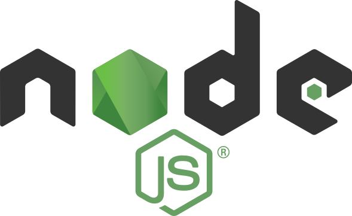

<p align="center">
  
</p>


# Backend Tutorial - Node.js a

Welcome to the **Backend Tutorial - Node.js** repository! This project documents my step-by-step learning journey in Node.js backend development 

---

## 📁 Repository Structure

```text
Backend-tutorial-nodeJS/
│
├── All the folders are arranged according to the concepts of Node JS 
```

### HOw can you get this in your system? 

Just clone my repository to your system : 

``` git clone https://github.com/SoumyaPatnaik1808/Backend-tutorial-nodeJS ``` 

then go to the specific folder
 
``` cd Backend-NodeJS ``` 


Install the dependencies into your system by running - ``` npm install ``` 

then finally you can run the script by : ``` node index.js ``` 


